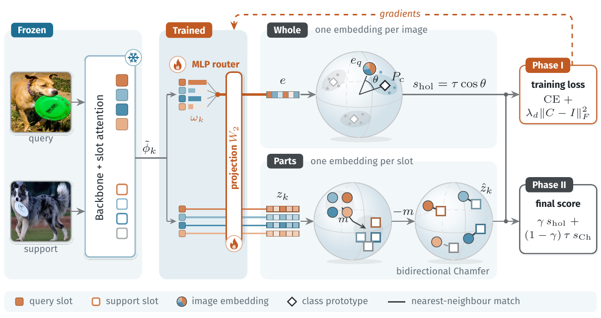
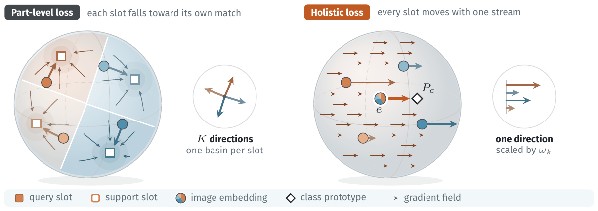
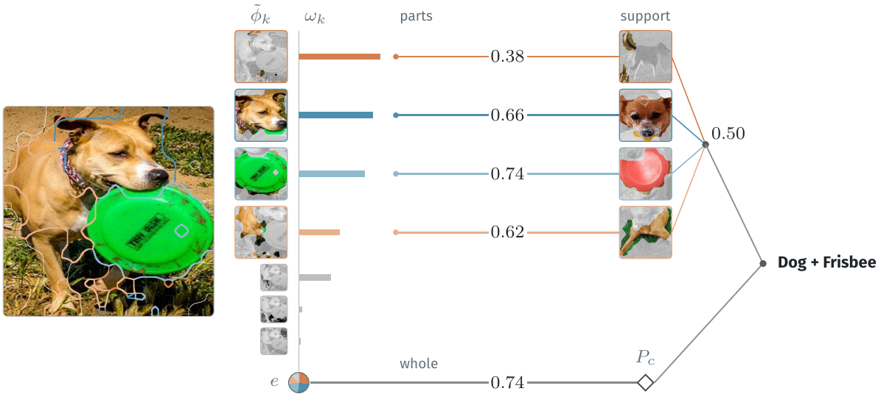

<h1 align="center">COMPOSE</h1>

<p align="center">
  <b>Unlocking Compositional Generalization in Continual Few-Shot Learning</b><br>
  Phu-Quy Nguyen-Lam<sup>1,&dagger;</sup>, Phu-Hoa Pham<sup>1,&dagger;</sup>, Dao Sy Duy Minh<sup>1</sup>,
  Chi-Nguyen Tran<sup>1</sup>, Huynh Trung Kiet<sup>1</sup>, Long Tran-Thanh<sup>2</sup><br>
  <sup>1</sup>University of Science, VNU-HCM &nbsp;&nbsp; <sup>2</sup>University of Warwick &nbsp;&nbsp;
  <sup>&dagger;</sup>Equal contribution<br>
  <b>NeurIPS 2026</b>
</p>

<p align="center">
  
</p>

COMPOSE reads one frozen set of object slots in two ways. During training the slots are scored
**as a whole** against class identity, which keeps the object-level geometry of a self-supervised
ViT intact. At test time the same slots are matched **part by part**, so concepts never seen in
training can be recognised from a few examples, without any gradient step.

- **Phase I (trained).** A frozen ViT with DINOSAUR slot attention turns each image into K slots.
  A small MLP router weights the slots and a shared projection maps them to an image embedding. Only
  the router and projection are trained, with a prototype cross-entropy and a cross-correlation
  penalty, over the continual sessions and with 20 replay exemplars per class.
- **Phase II (gradient-free).** The holistic score is blended with a bidirectional Chamfer score over
  the per-image centred slots of the query and the support set.

## Why decouple training from inference

<p align="center">
  
</p>

A part-level loss pulls every slot towards its own match, so the slot space splits into one basin per
slot and fits the training compositions. A holistic loss moves all slots along one direction, scaled
by the router weight, and leaves their relative geometry, the part that transfers to new concepts,
untouched. COMPOSE therefore trains holistically and composes only at inference.

## Main results

CFST benchmark, 10-way 10-shot, mean over 3 seeds (42, 123, 7) with 95% intervals (Table 4 of the
paper). `noc` tests concepts never seen in training; `H_a` is the harmonic mean over all splits.

| | sys | pro | sub | non | noc | H_a |
|---|---|---|---|---|---|---|
| **CGQA** COMPOSE | 90.17 ± .80 | 94.17 ± .43 | 93.23 ± .07 | 91.20 ± .82 | **93.46 ± .33** | 92.42 ± .25 |
| CGQA COMPOSE-CT (Chamfer in the loss) | 92.20 ± .79 | 95.32 ± .37 | 94.42 ± .46 | 93.20 ± .69 | 90.77 ± .53 | 93.15 ± .11 |
| **COBJ** COMPOSE | 81.38 ± .66 | 66.73 ± .80 | n/a | 76.07 ± .05 | 88.32 ± .49 | 77.31 ± .47 |
| COBJ COMPOSE-CT | 81.00 ± .57 | 67.56 ± .78 | n/a | 76.99 ± .77 | 87.82 ± .96 | 77.63 ± .40 |

<p align="center">
  
  <br><em>Phase II on a COBJ query (Dog + Frisbee, neither object appears in training): the slots
  with the largest router weights are matched to support slots, and the part score is blended with
  the holistic score.</em>
</p>

## Installation

```bash
git clone https://github.com/NLPQuy/COMPOSE.git && cd COMPOSE
conda env create -f environment.yml          # or: pip install -e ".[extract,dev]"
conda activate compose
pytest                                       # about 20 s on CPU, no data needed
```

Training needs only `torch`, `numpy`, `scipy` and `pyyaml`. The `extract` extra adds `timm`,
`torchvision`, `pillow` and `tqdm` for slot extraction; the `fscil` extra adds `datasets` for
miniImageNet.

## Data and checkpoint

1. **CGQA and COBJ** from the [CFST repository](https://github.com/NTU-LANTERN/CFST) (also on
   [Hugging Face](https://huggingface.co/datasets/jiangmingchen/CGQA_and_COBJ)):
   ```
   data/CFST/CGQA/GQA_100/{continual,fewshot}/...
   data/CFST/COBJ/annotations/{O365_*.json, continual/, fewshot/}
   ```
2. **DINOSAUR**, the released COCO model of [videosaur](https://github.com/martius-lab/videosaur)
   (DINOv2 ViT-B/14, 7 slots):
   ```bash
   wget -P checkpoints https://huggingface.co/andriizadaianchuk/dinosaur_dinov2/resolve/main/coco_dinosaur_base14_dinov2.ckpt
   ```

## Usage

**1. Extract slots.** The backbone and slot attention are frozen, so this runs once per dataset.

```bash
for ds in cgqa cobj; do
  python scripts/extract_slots.py --dataset $ds --cfst-root data/CFST \
      --checkpoint checkpoints/coco_dinosaur_base14_dinov2.ckpt --out data/slots
done
```

**2. Train and evaluate.** Each run trains one router per dataset and seed, then reads it with every
inference variant in the config on the same episodes.

```bash
python scripts/run.py configs/cfst/main.yaml --cfst-root data/CFST --slots data/slots
python scripts/summarize.py results/main --shot 10
```

Results go to `results/<experiment>/<dataset>/<run>_seed<seed>.json` with the router weights next to
them. Finished runs are skipped, so the same command resumes an interrupted experiment;
`--datasets`, `--runs` and `--seeds` select a subset. `summarize.py` prints the tables above.

## Reproducing the paper

| Paper | Command |
|---|---|
| Tables 1, 4 (main), inference ablations of Tables 3, 9, shots (Table 19), Hungarian matcher (Table 20) | `scripts/run.py configs/cfst/main.yaml` |
| Training ablations of Tables 3, 9 and the λ_d sweep (Table 17) | `scripts/run.py configs/cfst/ablation.yaml` |
| Train × inference cross-ablation (Tables 22, 24) | `scripts/run.py configs/cfst/cross_ablation.yaml` |
| Other patch sources (Tables 2, 7, 8, 23, 25) | `scripts/run.py configs/cfst/backbones.yaml` |
| Few-shot class-incremental learning (Table 10) | `scripts/run_fscil.py configs/cil/fscil.yaml` |
| Class-incremental learning with ViTs (Table 11) | `scripts/run_cil.py configs/cil/vit_cil.yaml` |

<details>
<summary><b>Other patch sources</b> (Tables 2, 7, 8, 23, 25)</summary>

The DINOSAUR attention maps are kept and only the tokens they average change
(`compose/slots/backbones.py`). Each backbone has a file in `configs/backbones/`:

```bash
python scripts/extract_slots.py --dataset cgqa --cfst-root data/CFST --out data/slots \
    --checkpoint checkpoints/coco_dinosaur_base14_dinov2.ckpt --patch-source configs/backbones/openclip_l14.yaml
python scripts/run.py configs/cfst/backbones.yaml --cfst-root data/CFST --slots data/slots
```

Backbones with 14-pixel patches (OpenCLIP ViT-L/14, MAE ViT-H/14, EVA-02 ViT-B/14) use the released
DINOv2 DINOSAUR. Backbones with 16-pixel patches (DINOv1 and iBOT ViT-B/16, SAM ViT-B/16) need a
DINOSAUR trained on DINOv1 ViT-B/16 as `--checkpoint`. iBOT, MAE and SAM weights are passed with
`--source-checkpoint`; the others come from timm.
</details>

<details>
<summary><b>Class-incremental learning with ViTs</b> (Table 11)</summary>

```bash
python scripts/run_cil.py configs/cil/vit_cil.yaml \
    --root cifar224=data/cifar --root imagenetr=data/imagenet-r --root imageneta=data/imagenet-a \
    --checkpoint checkpoints/coco_dinosaur_base14_dinov2.ckpt
```

As for every method in Table 11, the DINOv2 backbone is first adapted on the base session with the
RanPAC recipe of [LAMDA-PILOT](https://github.com/sun-hailong/LAMDA-PILOT): AdaptFormer adapters and a
cosine classifier are trained for 20 epochs with SGD, then the backbone is frozen. Slot features combine
the DINOSAUR attention maps with the tokens of the adapted backbone. The router is meta-trained on the
base session (1000 episodes) and for 200 episodes on each later session; a replay buffer keeps 20
exemplars per seen class and test images are scored with the COMPOSE blend against it. CIFAR-100 is
downloaded automatically; ImageNet-R and ImageNet-A use the `train/` and `test/` splits of LAMDA-PILOT.
</details>

<details>
<summary><b>Few-shot class-incremental learning</b> (Table 10)</summary>

```bash
git clone --depth 1 https://github.com/icoz69/CEC-CVPR2021 data/CEC      # session splits
pip install -e ".[fscil]"                                               # miniImageNet from Hugging Face
python scripts/run_fscil.py configs/cil/fscil.yaml --index-dir data/CEC/data/index_list \
    --root cifar100=data/cifar --root cub200=data/cub \
    --checkpoint checkpoints/coco_dinosaur_base14_dinov2.ckpt
```

The protocol follows CEC and Comp-FSCIL: CIFAR-100 and miniImageNet have 60 base classes and 8 sessions
of 5-way 5-shot; CUB-200 has 100 base classes and 10 sessions of 10-way 5-shot. The backbone and slot
attention stay frozen and the router is meta-trained on the base session only. The support set starts
with 5 images per base class and grows with the few-shot images of every session.
</details>

## Code layout

```
compose/
  data/cfst.py          CFST file lists, labels and protocol constants
  data/sampling.py      class-incremental sessions and few-shot episodes
  data/slot_store.py    pre-extracted slot store
  slots/dinosaur.py     frozen DINOSAUR and the slot readout
  slots/backbones.py    other patch sources (DINOv1, iBOT, OpenCLIP, MAE, SAM, EVA-02)
  model/router.py       MLP router, projection W2, cross-correlation penalty (Phase I)
  model/matching.py     centring, top-κ slots, Chamfer and Hungarian matching
  model/inference.py    Phase II scoring
  model/ct.py           COMPOSE-CT ablation (Chamfer in the training loss)
  engine/               meta-training, continual loop, few-shot evaluation, runner
  cil/                  class-incremental benchmarks: data, adapter ViT, base session, loop
  fscil/                few-shot class-incremental benchmarks
  metrics.py            Acon / AIA / FF / BWT and A_m / Hn / Hr / Ha
  config.py             experiment configuration (defaults are the paper settings)
configs/                one YAML file per group of tables
scripts/                extract_slots.py, run.py, summarize.py, run_cil.py, run_fscil.py
tests/                  unit and end-to-end tests on synthetic data
```

## Citation

```bibtex
@inproceedings{nguyenlam2026compose,
  title     = {Unlocking Compositional Generalization in Continual Few-Shot Learning},
  author    = {Nguyen-Lam, Phu-Quy and Pham, Phu-Hoa and Dao, Sy Duy Minh and Tran, Chi-Nguyen
               and Huynh, Trung Kiet and Tran-Thanh, Long},
  booktitle = {Advances in Neural Information Processing Systems},
  year      = {2026}
}
```

## Acknowledgements

The DINOSAUR model and checkpoint come from [videosaur](https://github.com/martius-lab/videosaur)
(MIT licence). CGQA and COBJ and their protocol come from [CFST](https://github.com/NTU-LANTERN/CFST).
The FSCIL session splits come from [CEC](https://github.com/icoz69/CEC-CVPR2021) and
[Comp-FSCIL](https://github.com/Zoilsen/Comp-FSCIL). The adapter ViT and the base-session recipe follow
[LAMDA-PILOT](https://github.com/sun-hailong/LAMDA-PILOT) (MIT licence).

## License

MIT, see [LICENSE](LICENSE).
